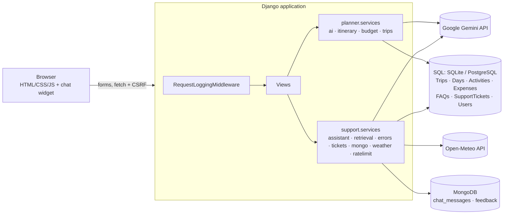

# TripCraft AI

> *Your journey, intelligently planned.*

TripCraft AI is a full-stack Django web application that turns a destination, dates, budget, group size and interests into a personalised day-by-day itinerary using Google Gemini, with a deterministic budget optimiser, an interactive dashboard, destination weather, and an AI support assistant backed by an SQL FAQ database, a central error-code registry, SQL support tickets and MongoDB chat logs.

| | |
|---|---|
| **Live website** | _Not deployed yet — add the verified `https://…onrender.com` URL here after deployment_ |
| **GitHub repository** | _Add the repository URL here after pushing_ |
| **Health check** | `/health/` (liveness) and `/health/ready/` (readiness) |

---

## 1. Problem statement

Planning a trip means juggling many tabs: attractions, food, transport, and a budget spreadsheet that rarely matches the plan. Students and first-time travellers in particular need a realistic plan that fits a fixed budget, plus somewhere to get help when something goes wrong.

## 2. Objectives

1. Generate personalised, realistic day-by-day itineraries with AI.
2. Keep all budget arithmetic exact and transparent, and never left to the AI.
3. Let users explore and adjust the plan interactively, then save or print it.
4. Provide in-product support: FAQs, an error-code guide, an AI assistant and support tickets.
5. Be secure, testable and deployable on Render.

## 3. Key features

**Travel planner**
- **AI itinerary generator** (`/plan/`): a 3-step validated form → Gemini structured JSON → validated and stored itinerary with time slots, durations, neighbourhoods, per-person costs, meals, travel/rest breaks and a "why this fits you" summary.
- **Transparent fallback**: if the AI is unavailable, a clearly labelled *sample* itinerary is built from local templates and the dashboard shows **TRIPCRAFT_001**.
- **Smart budget optimiser**: integer-exact calculations in Python (`planner/services/budget.py`) mirrored in JavaScript (`budget.js`), with a test that proves both give identical numbers. It covers meal and stay styles, user-entered transport and extras figures, a 0–30% contingency, and a "trim paid activities" preview that shows the savings before you apply it.
- **Interactive dashboard**: day tabs, expandable activity cards, mark done / remove / restore, live totals, a doughnut chart by category and a stacked daily bar chart (Chart.js), plus a print/PDF layout.
- **Weather** (third-party API): Open-Meteo forecast for the trip dates, loaded asynchronously, with a timeout and fallback.
- **Saved trips**: anonymous trips are kept in the browser session; optional accounts (username and password only) keep them permanently.

**Help & support**
- **FAQ & Help centre** (`/faq/`): 14 FAQs loaded from SQL, with live search, topic filters, an accessible accordion, the error-code guide and a ticket form.
- **AI support assistant**: a floating widget on every page, including the 404 and 500 pages. It retrieves FAQs and error codes, answers with Gemini using only that context, falls back to verified help-centre text, and offers a support ticket when it can't answer.
- **Support tickets** in SQL with references like `TC-ABCD2345`, created only after the user confirms.
- **Chat logs and feedback** in MongoDB (thumbs up/down).
- **Custom error pages** for 400, 401, 403, 404, 429, 500 and 503, each with an "Ask the assistant" button.
- **Request logging** middleware, **health endpoints** and **rate limiting** on AI operations.

### What is AI and what is deterministic

| AI-powered (Gemini) | Deterministic application logic |
|---|---|
| Itinerary content (activities, meals, descriptions, cost *estimates*) | All budget totals, percentages, per-day and per-person figures |
| Assistant replies, written from retrieved FAQ / error-registry context | FAQ retrieval (token/IDF scoring), error-code detection |
| — | Validation of every AI field, fallback planner, tickets, weather parsing |

No machine-learning model is trained in this project.

## 4. Technology stack

Python 3.13+, Django 6.0 (ORM, forms, templates, auth), SQLite (development) or PostgreSQL (production, via `DATABASE_URL`), MongoDB via PyMongo, Google Gemini via the official `google-genai` SDK, Open-Meteo via `requests`, vanilla JavaScript with the Fetch API, Chart.js 4, WhiteNoise, Gunicorn and Render.

## 5. Architecture



```
tripcraft/            project settings, URLs (incl. error handlers), WSGI
planner/              travel planner app
  models.py           Trip, ItineraryDay, Activity, Expense
  forms.py            TripForm (server-side validation), BudgetSettingsForm, SignUpForm
  services/ai.py      Gemini provider (replaceable), prompt, structured schema
  services/itinerary.py  validation/normalisation of AI output
  services/fallback.py   labelled local sample planner
  services/budget.py     budget engine (mirrored in static/planner/js/budget.js)
  services/trips.py      persistence + ownership rules
  views/              pages.py, api.py (JSON), accounts.py
support/              help & support app
  models.py           FAQ, SupportTicket
  faq_data.py         FAQ content (seeded by migration 0002 and `seed_faqs`)
  services/errors.py  central error-code registry
  services/retrieval.py  FAQ retrieval
  services/assistant.py  assistant pipeline
  services/mongo.py   MongoDB chat log + feedback
  services/weather.py Open-Meteo client
  services/ratelimit.py, services/tickets.py
  middleware.py       request logging
  views/              help.py, chat.py, health.py, errors.py
  templates/          faq, ticket, 400/401/403/404/429/500/503, chat widget partial
```

## 6. SQL database design

| Model | Key fields |
|---|---|
| **Trip** | UUID id, optional `user` FK, destination, origin, start/end date (check constraint end ≥ start), budget (> 0), currency, travellers (1–20), interests (JSON), pace, transport, dietary, accessibility, notes, `source` (ai/sample), ai_model, fallback_reason, overview, tips, contingency %, meal/stay style, estimated_total |
| **ItineraryDay** | trip FK, day_number (unique per trip), date, title, summary, notes, meals (JSON), estimated_cost |
| **Activity** | day FK, order, time_slot, name, description, duration, location, category, cost_per_person, is_completed, is_removed |
| **Expense** | trip FK, category (transport/accommodation/misc, unique per trip), description, estimated_amount, source (AI/sample), user_amount (override) |
| **FAQ** | question (unique), answer, category, keywords, order, is_active, created_at, updated_at |
| **SupportTicket** | reference `TC-XXXXXXXX` (unique), optional user FK, session_key, optional contact_email, subject, description, error_code, status (OPEN/IN_PROGRESS/RESOLVED), priority, channel (assistant/help form), conversation_id, created_at, updated_at |

## 7. MongoDB storage design

Database: `MONGODB_DB_NAME` (default `tripcraft`). MongoDB is used **only** for these two collections. Nothing else is stored there, and they are never stored in SQL.

**`chat_messages`**: `conversation_id`, `session_ref`, `user_id`, `role` (user/assistant/system), `text` (≤ 2,000 chars), `kind` (faq/error_code/travel/no_answer/ticket_prompt/ticket_created/greeting), `error_codes`, `faq_ids`, `ai_used`, `resulted_in_ticket`, `ticket_reference`, `response_status`, `created_at`.

**`feedback`**: `conversation_id`, `message_id` (the assistant message's `_id`), `rating` (up/down), `comment`, `session_ref`, `created_at`.

**Failure behaviour**: PyMongo uses short timeouts (`MONGODB_TIMEOUT_MS`). If a write fails, the error *type* is logged (never the URI), MongoDB is skipped for 30 seconds, and the site keeps working. The widget shows "Not saved to chat history" and feedback returns `saved: false`, so users are never told something was saved when it wasn't.

**Development mode**: if `MONGODB_URI` is empty, chat and feedback logging are disabled and `/health/ready/` reports `"mongodb": "not_configured"`. **The MongoDB assessment requirement is only fully met once a real MongoDB (for example Atlas) is configured and verified** (see §14).

## 8. AI assistant workflow

1. The widget posts `{message}` to `POST /support/chat/` (CSRF-protected, max 1,000 chars, rate-limited to 20 per minute).
2. Intent checks: greetings, and explicit "create a ticket / contact support" requests.
3. **Retrieval**: `errors.detect()` finds codes (such as "404" or "TRIPCRAFT_001", or phrases like "itinerary generation fails"), and `retrieval.search()` ranks active FAQs from SQL.
4. **AI step** (if `GEMINI_API_KEY` is set): the retrieved context, the last 6 chat turns and the question go to Gemini with strict instructions. The reply must follow a JSON schema `{answer, answerable, topic}`, which is validated and length-capped. General travel tips are allowed but labelled "General travel advice — please verify".
5. **Fallback**: if the AI is missing or fails (timeout, 429, invalid JSON), the reply comes directly from the matching error-registry entry or FAQ and is labelled "Help centre", not "AI-assisted".
6. **No reliable answer**: "I couldn't find a reliable answer in the available help information. Would you like me to create a support ticket?"
7. User and assistant messages are logged to MongoDB.

### FAQ retrieval

Text is lower-cased and tokenised, stop words are removed, and words get light suffix stemming. Each FAQ's question and keywords count double and its answer counts single. Every shared token is weighted by inverse document frequency, and the score is normalised by query length. Results below a threshold are discarded, so off-topic questions don't get a misleading FAQ.

## 9. Error codes

All codes live in `support/services/errors.py` and are used by the error pages, the help centre and the assistant.

| Code | Title | Where TripCraft produces it | What to do |
|---|---|---|---|
| 400 | Bad Request | Invalid/malformed JSON or form data on dashboard, chat and ticket endpoints; Django `handler400` | Check input and retry |
| 401 | Unauthorized | Opening an account-owned support ticket while logged out | Log in |
| 403 | Forbidden | Another account's ticket; failed CSRF check (`CSRF_FAILURE_VIEW`) | Reload; log in with the right account |
| 404 | Not Found | Unknown URLs (`handler404`); trips/tickets you don't own (hidden as 404) | Check the URL, open My trips |
| 429 | Too Many Requests | Itinerary generation/regeneration (6 per 10 min) and assistant (20/min), per IP | Wait and retry |
| 500 | Internal Server Error | Any unhandled exception (`handler500`); generic message, no traceback; plain-HTML fallback if the template itself fails | Retry; create a ticket |
| 503 | Service Unavailable | `/health/ready/` when the DB is down; ticket creation when the DB write fails; feedback when MongoDB is unavailable | Retry later |
| **TRIPCRAFT_001** | Live AI itinerary generation unavailable | Trip dashboard whenever a sample itinerary replaces live AI (no key, timeout, rate limit, invalid AI output) | Use the sample; "Try live AI again" |

## 10. Support-ticket workflow

1. The assistant offers a ticket, or the user asks for one, or uses the form on `/faq/#contact-support`.
2. The widget shows a prefilled form (subject, description, error code, optional email). **Nothing is created until the user selects "Confirm & create ticket"**, and the API rejects requests without `confirm: true`.
3. The server validates the data (subject ≥ 4 chars, description 10–2,000 chars, valid email if given).
4. `SupportTicket` is saved in SQL with a unique `TC-` reference.
5. The reference and link are returned **only after the database write succeeds**. On failure the API returns 503 with no reference.
6. The outcome is logged to MongoDB (`resulted_in_ticket`, `ticket_reference`).
7. `/support/tickets/<ref>/` is visible only to the creating browser session or the owning account (otherwise 404, 401 or 403). Staff manage tickets in Django admin (`/admin/`). **No emails are sent**, and the UI says so.

## 11. Weather integration (Open-Meteo)

`support/services/weather.py` geocodes the destination and requests a daily forecast (weather code, max/min temperature, rain probability) for the trip dates.
- Timeout: `WEATHER_TIMEOUT_SECONDS` (default 4 s) for each call.
- Connection errors, HTTP errors, invalid JSON and missing fields return an "unavailable" result. Weather is never invented.
- Dates beyond the ~16-day forecast window give a clear "not available yet" message, and no API call is made.
- Results are cached for 30 minutes and shown with their fetch time, so stale data isn't presented as current.
- The dashboard loads weather after the page renders, so a slow API never blocks the itinerary.

Open-Meteo needs no API key and is free for non-commercial use. Check its terms for other uses.

## 12. Logging and health checks

- `support.middleware.RequestLoggingMiddleware` logs timestamp, method, path (no query string), status, duration (ms) and a request id, and returns `X-Request-ID`. 4xx responses are logged at WARNING and 5xx at ERROR. Request bodies and chat text are not written to logs.
- `GET /health/` returns `200 {"status": "ok"}` (liveness; this is Render's `healthCheckPath`).
- `GET /health/ready/` returns `200` or `503`: `{"status", "checks": {"database"}, "optional": {"mongodb", "ai"}}`. Only the SQL database decides readiness. MongoDB, AI and weather are optional and don't make the site unhealthy. No hostnames or credentials are exposed.

## 13. Security

CSRF protection on every POST, including fetch calls with `X-CSRFToken`. Server-side validation for all forms and JSON. Template auto-escaping, and the widget renders text with `textContent`. ORM-only queries. Secrets come from environment variables, and the Gemini key is only ever used on the server. Requests are capped at 256 KB and inputs have length limits. Rate limiting covers AI endpoints. Trip and ticket access checks hide other users' data. In production: `DEBUG=False`, HTTPS redirect, secure cookies, HSTS, `SECURE_PROXY_SSL_HEADER`, and the Render hostname is auto-added to `ALLOWED_HOSTS`/`CSRF_TRUSTED_ORIGINS`. User notes are delimited in prompts and treated as preferences, not instructions.

## 14. Local setup

```bash
python -m venv .venv
```
```bash
.venv\Scripts\activate          # Windows  (macOS/Linux: source .venv/bin/activate)
```
```bash
pip install -r requirements.txt
```
```bash
copy .env.example .env          # macOS/Linux: cp .env.example .env — then edit values
```
```bash
python manage.py migrate        # creates tables and seeds the 14 FAQs
```
```bash
python manage.py runserver
```

Open http://127.0.0.1:8000. Without `GEMINI_API_KEY` the app runs in clearly labelled fallback mode. Optional: `python manage.py createsuperuser` to manage FAQs and tickets at `/admin/`, and `python manage.py seed_faqs` to re-apply FAQ content (it is idempotent).

### Environment variables

| Variable | Required | Purpose |
|---|---|---|
| `SECRET_KEY` | **Yes** in production | Django signing key (a local fallback exists only when `DEBUG=True`) |
| `DEBUG` | Yes | `False` in production |
| `ALLOWED_HOSTS` | Yes (non-Render) | Comma-separated hostnames |
| `CSRF_TRUSTED_ORIGINS` | For custom domains | e.g. `https://tripcraft.example.com` |
| `DATABASE_URL` | Production | PostgreSQL URL; SQLite is used when unset |
| `GEMINI_API_KEY` | For live AI | Google AI Studio key |
| `GEMINI_MODEL` | No | Default `gemini-2.5-flash`; change if the model is retired |
| `AI_TIMEOUT_SECONDS`, `AI_MAX_OUTPUT_TOKENS` | No | AI limits (60 s, 16,000) |
| `MONGODB_URI` | For the MongoDB requirement | Atlas/other MongoDB connection string |
| `MONGODB_DB_NAME` | No | Default `tripcraft` |
| `MONGODB_TIMEOUT_MS` | No | Default 2500 |
| `WEATHER_TIMEOUT_SECONDS` | No | Default 4 |
| `RATE_LIMIT_GENERATE`, `RATE_LIMIT_CHAT` | No | Defaults 6 per 10 min, 20 per min |
| `SECURE_SSL_REDIRECT`, `SECURE_HSTS_SECONDS` | No | Production HTTPS tuning |

### MongoDB Atlas setup

1. Create a free cluster at https://www.mongodb.com/atlas.
2. Under **Database Access**, add a user with a strong password and the *readWrite* role.
3. Under **Network Access**, allow your IP for local testing. For Render, allow `0.0.0.0/0` or Render's outbound IPs, which are listed in the service's *Connect → Outbound* tab.
4. Under **Connect → Drivers**, copy the `mongodb+srv://…` string, insert the password, and set it as `MONGODB_URI`. Never commit it.
5. Verify: `/health/ready/` shows `"mongodb": "ok"`. Then send a chat message and confirm documents appear in `tripcraft.chat_messages`, and give a thumbs-up and confirm a document in `feedback`.

## 15. Tests

```bash
python manage.py test
```

The suite has 82 tests. AI, weather and MongoDB are mocked (an injected fake database), so no API keys or quota are needed. One test uses the real PyMongo driver against an unreachable address to check graceful failure. Coverage includes:
- The home, plan and FAQ pages, including the widget on each.
- FAQs seeded (≥ 10) and read from SQL, and the seed command's idempotency.
- Chat endpoint responses, 400s, 405s, CSRF 403, and the rate limit 429.
- FAQ-grounded AI prompts and the deterministic fallback.
- 404, 500 and TRIPCRAFT_001 explanations, and all eight codes being present in the registry.
- Unanswerable questions offering a ticket, confirmed tickets stored in SQL, and no reference returned on DB failure.
- Ticket access returning 401, 403 and 404 for the wrong visitor.
- MongoDB logging and feedback, plus their failure handling.
- Weather timeouts, HTTP errors, malformed data and out-of-range dates.
- Health, readiness 503, and request logging.
- A custom 404 for an invalid URL with `DEBUG=False`, the safe 500 page and its plain-HTML fallback.
- Form validation for dates and budgets.
- Budget maths, plus exact Python-to-JavaScript parity (requires Node.js; skipped otherwise).
- AI JSON parsing of valid, malformed, oversized and invalid values.
- Trip persistence and edits, and per-user and per-session trip privacy.

Further checks: `python manage.py check --deploy` (with production variables) and `node --check` on each JS file.

## 16. Deploying to Render

1. Push this repository to GitHub (`.env`, `db.sqlite3` and `staticfiles/` are git-ignored).
2. In Render, choose **New → Blueprint**, select the repo, and Render reads `render.yaml`. It creates the **tripcraft-ai** web service and the **tripcraft-db** PostgreSQL database. *Check Render's current plans: if `plan: free` isn't offered to your account, change it to a paid plan in `render.yaml` or in the dashboard.*
3. When prompted, set the secret variables marked `sync: false`:
   - `GEMINI_API_KEY`: from https://aistudio.google.com/app/apikey
   - `MONGODB_URI`: from Atlas (§14)

   `SECRET_KEY` is generated automatically, `DATABASE_URL` comes from the database, and `DEBUG=False` is preset.
4. The build runs `build.sh`: install, `collectstatic`, `migrate` (which seeds the FAQs) and `seed_faqs`. The start command is `gunicorn tripcraft.wsgi:application --workers 2 --timeout 120`, and the health check is `/health/`.
5. **Manual (non-Blueprint) alternative**: create a PostgreSQL database and a Python web service, set the build command `./build.sh`, the start command above, the health check path `/health/`, and the environment variables `DEBUG=False`, `SECRET_KEY`, `DATABASE_URL` (the internal URL), `GEMINI_API_KEY`, `MONGODB_URI` and `MONGODB_DB_NAME`.
6. **Verify on the live URL**:
   - HTTPS works and `/`, `/plan/` and `/faq/` load with the chat widget.
   - The FAQ list comes from the DB.
   - `/does-not-exist/` shows the custom 404.
   - `/health/` and `/health/ready/` return `ok`.
   - Plan a trip and ask the assistant a question.
   - Create a ticket, then check it in `/admin/` (use the Render Shell to run `python manage.py createsuperuser`).
   - Confirm MongoDB documents arrive.

   Only then add the URL at the top of this README.

## 17. Example user journeys

- **Plan**: Home → *Plan your trip* → "Jaipur, 4 days, ₹45,000, 2 travellers, culture + food" → dashboard → switch to Day 2 → remove a paid activity → choose "Budget eateries" → watch the totals and charts update → *Print / save PDF*.
- **Help**: on any page, open *Ask TripCraft* → "What does error 429 mean?" → registry explanation → 👍 feedback.
- **Ticket**: "The itinerary generator keeps failing with an unknown error" → the relevant FAQ plus a *Create a support ticket* button → confirm → `TC-…` reference and link.

## 18. Known limitations

- Costs are AI or proportional **estimates**. No prices, opening hours or availability are verified.
- Rate limiting uses Django's local-memory cache, so limits apply per Gunicorn worker. Use Redis for strict limits at scale.
- No outbound email: tickets are reviewed in Django admin.
- Anonymous trips and tickets depend on the browser session (2 weeks by default).
- Weather is only available within Open-Meteo's ~16-day forecast window.
- The default `gemini-2.5-flash` model id may be retired by Google over time. Set `GEMINI_MODEL` to a current model.
- Live Gemini and MongoDB behaviour is verified with mocks in tests. Real connections must be verified after you add credentials.

## 19. Proposed future improvement

**Ticket follow-up with email notifications and a "My support tickets" page**: send confirmation and status-change emails through a transactional email provider such as SendGrid, configured via environment variables, and let signed-in users track all their tickets in one place. This would close the support loop without users needing to keep their ticket reference.

## 20. Credits

Photography from Unsplash (Unsplash License), stored locally in `planner/static/planner/img/`. Weather data by [Open-Meteo](https://open-meteo.com/) (CC BY 4.0). Charts by Chart.js (MIT).
